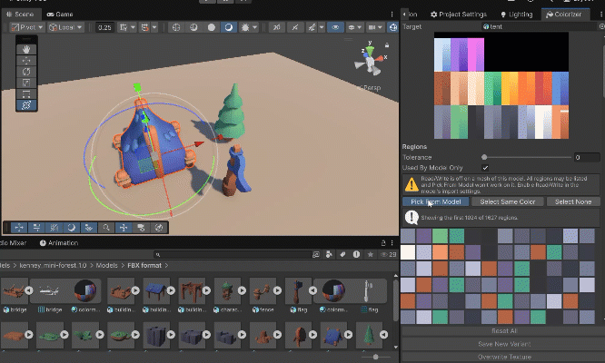

# Viol3's Colorizer

Recolor low poly models that use a color atlas, the small texture made of flat color cells. Click a part of the model, pick a new color and see the result live, without leaving Unity.



> **Early development:** This package is at an early stage (v0.0.1), so you may run into bugs or rough edges. If something breaks, behaves unexpectedly or a feature is missing, please [open an issue](https://github.com/viol3/colorizer/issues). Your Unity version and steps to reproduce help a lot. Feedback and suggestions are very welcome.

## Features

- **Automatic regions:** finds the color cells in the atlas and lists the ones the model's UVs actually use
- **Three ways to select:** click the model in the Scene view, the atlas or a color swatch
- **Live preview:** changes show on the model right away, without touching materials, textures or the scene until you save
- **Palettes:** eight built-in palettes, your own palette assets, mapping by brightness and shuffling
- **Random variants:** hue shift and random colors with saturation and brightness ranges
- **Two ways to save:** a new texture and material for this object, or over the original texture
- **Undo:** color changes can be undone until you save
- **Open source:** full C# source, works with any shader that has a main texture

## Installation

### From a Git URL

1. Open **Window > Package Manager**.
2. Click **+** and choose **Add package from git URL...**
3. Enter:

```
https://github.com/viol3/colorizer.git
```

### From a local folder

Copy the `com.viol3.colorizer` folder into your project's `Packages` folder. Unity picks it up automatically.

**Requirements:** Unity 2021.3 or newer. The package is editor-only and adds nothing to your builds.

## Quick Start

1. Open **Tools > Viol3's Colorizer**.
2. Select a model in the scene.
3. Click a swatch, or turn on **Pick From Model** and click the model.
4. Change the **Color**.
5. Click **Save New Variant**.

## Saving

| Button | What it does |
|---|---|
| **Save New Variant** | Writes a new PNG and a copy of each material, then assigns them to the target. The originals stay as they are. Assigning the materials can be undone, the created files stay. |
| **Overwrite Texture** | Replaces the source file, so everything that uses the texture changes. This can't be undone in Unity. Works with PNG, TGA and JPG. |

## Settings

- **Tolerance:** how different two pixels can be and still count as one region. Raise it for JPG or compressed textures.
- **Used By Model Only:** hides regions the model's UVs never touch.
- **Select Same Color:** adds every listed region with the same original color. Useful when one color appears in separate cells.
- **Palettes and Random Variants:** change the selected regions, or all listed regions if nothing is selected. Clicking a palette color applies it to the selection.

To make your own palette, use **Assets > Create > Viol3's Colorizer > Color Palette**.

## Notes

- Works best on flat color atlases. Gradients and detailed textures split into many tiny regions.
- **Used By Model Only** and **Pick From Model** read the mesh, so the model needs **Read/Write** enabled in its import settings. Without it, all regions are listed and you can still select from the swatches and the atlas.
- PNG and JPG are read from the source file for exact colors. Other formats are read from the imported texture, so compression can add noise. Raising **Tolerance** helps.
- The window follows your selection until you have unsaved changes.
- Unsaved colors are lost if you change the target, the texture or the tolerance. Unity asks first.

## Reporting Bugs

Found a bug or have an idea? [Open an issue](https://github.com/viol3/colorizer/issues) and include:

- Your Unity version and render pipeline
- What you did, what you expected and what happened instead
- Any errors from the Console

## Changelog

See [CHANGELOG.md](CHANGELOG.md).

## License

Released under the [MIT License](LICENSE.md).
